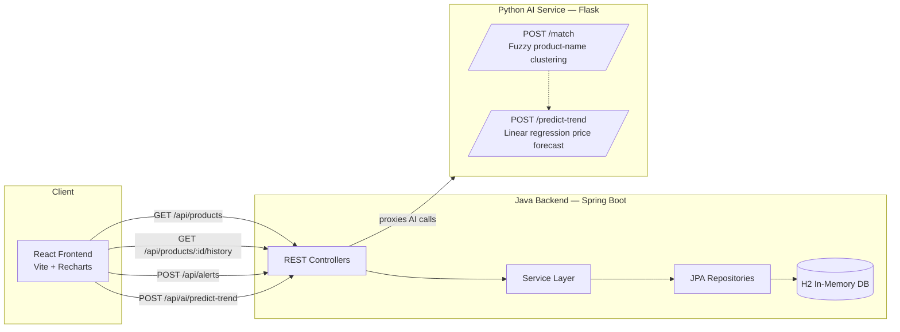

# PriceScout

**Compare the same product across retailers, see what it really costs after shipping, and get a buy-or-wait hint.**

    

---

## Screenshots

| Search and comparison | Product detail with price history |
|---|---|
|  |  |

| AI price prediction | Price drop alert |
|---|---|
|  |  |

A short walkthrough (about 20 seconds) is in [`demo-video.mp4`](demo-video.mp4). It covers browsing, search, a price comparison, the history chart, the trend prediction and setting an alert.

---

## Why I built it

When you shop for electronics, the same product is usually listed on Amazon, Flipkart, eBay and others at different prices, with different shipping costs, and often under slightly different titles. The cheapest sticker price isn't always the cheapest option once shipping is added.

PriceScout pulls those listings together and does five things:

1. Shows prices for the same product across several platforms.
2. Adds shipping to the price, so "best deal" means what you'd actually pay.
3. Matches messy titles using fuzzy text matching, so "Apple iPhone 15 128GB Blue" and "iPhone15 128 GB (Blue) - Apple" are treated as one product.
4. Predicts whether a price is rising, falling or stable, so you can decide to buy now or wait.
5. Lets you save a target price for a product, so you can be told when it drops below it.

It's a portfolio project. I wanted to build a REST API in Spring Boot, split the work across two services that talk over HTTP, apply some basic NLP to a real data-quality problem, and wire it all into a React frontend.

---

## Architecture



**Why two backend services?** The Java API handles the core data and stays simple. The matching and prediction code lives in a separate Python service, so it can be changed, redeployed or replaced with a heavier model without touching the main API. It's also how you'd realistically split this kind of system.

---

## Tech stack

| | |
|---|---|
| **Backend API** | Java 17, Spring Boot 3.3, Spring Data JPA |
| **Database** | H2 (in-memory), so there's nothing to install |
| **AI service** | Python 3, Flask, RapidFuzz, NumPy |
| **Frontend** | React 18, Vite, Recharts |
| **Communication** | REST over HTTP and JSON |

---

## Features

- Search and browse products by name, brand or category
- Price comparison that includes shipping, sorted lowest to highest, with the best deal highlighted
- Price history chart for each platform
- Trend prediction (rising, falling or stable) with a confidence score and a plain-English recommendation
- Product matching that groups differently worded titles into one product
- Price drop alerts saved with an email and a target price
- Seed data included: 6 products across 4 platforms, with 3 historical price points each, so the app is populated as soon as it starts

---

## Project structure

```
price-compare-app/
├── backend/                  Java Spring Boot API
│   ├── src/main/java/com/pricecompare/
│   │   ├── controller/       REST endpoints
│   │   ├── service/          Business logic and AI service client
│   │   ├── repository/       Spring Data JPA repositories
│   │   ├── model/            JPA entities
│   │   └── dto/              Response DTOs
│   └── src/main/resources/
│       ├── application.properties
│       └── data.sql          Seed data, loaded on startup
├── ai-service/               Python Flask service
│   ├── app.py                Routes
│   ├── matching.py           Fuzzy product-name clustering
│   └── price_predictor.py    Linear regression trend prediction
├── frontend/                 React + Vite
│   └── src/
│       ├── components/
│       ├── api.js            API client
│       └── App.jsx
├── screenshots/
└── README.md
```

---

## Running it

You need Java 17+, Maven 3.9+, Python 3.10+ and Node.js 18+. Start the three parts in this order, each in its own terminal.

**1. AI service (port 5001)**

```bash
cd ai-service
pip install -r requirements.txt
python app.py
```

Check it with `curl http://localhost:5001/health`.

**2. Java backend (port 8080)**

```bash
cd backend
mvn spring-boot:run
```

H2 runs in memory and loads the seed data from `data.sql` each time, so there's no database setup. Check it with `curl http://localhost:8080/api/products`, which should return the 6 seeded products. If you want to look at the data directly, the H2 console is at `http://localhost:8080/h2-console` (JDBC URL `jdbc:h2:mem:pricecompare`, user `sa`, blank password).

**3. Frontend (port 5173)**

```bash
cd frontend
npm install
npm run dev
```

Then open http://localhost:5173.

---

## API

### Java backend (`http://localhost:8080/api`)

| Method | Endpoint | What it does |
|---|---|---|
| GET | `/products` | List all products with price comparisons |
| GET | `/products/search?query=...` | Search by name, brand or category |
| GET | `/products/{id}` | Full comparison for one product |
| GET | `/products/{id}/history` | Price history across all platforms |
| POST | `/alerts` | Create a price alert: `{ productId, email, targetPrice }` |
| POST | `/ai/match` | Passes the request to the AI service's matching endpoint |
| POST | `/ai/predict-trend` | Passes the request to the AI service's prediction endpoint |

### AI service (`http://localhost:5001`)

| Method | Endpoint | What it does |
|---|---|---|
| GET | `/health` | Liveness check |
| POST | `/match` | `{ "names": [...] }` returns clustered product groups |
| POST | `/predict-trend` | `{ "history": [871.84, 839.55, 807.26] }` returns a trend and a predicted next price |

Example of the matching endpoint:

```bash
curl -X POST http://localhost:5001/match \
  -H "Content-Type: application/json" \
  -d '{"names": ["Apple iPhone 15 128GB Blue", "iPhone15 128 GB (Blue) - Apple", "Samsung Galaxy S24 256GB Black"]}'
```

```json
{
  "cluster_count": 2,
  "clusters": [
    { "canonical_name": "Apple iPhone 15 128GB Blue", "members": [...], "avg_confidence": 94.2 },
    { "canonical_name": "Samsung Galaxy S24 256GB Black", "members": [...], "avg_confidence": 100.0 }
  ]
}
```

---

## How the AI parts work

**Product matching** (`matching.py`). Each title is cleaned first: lowercased, punctuation removed, and filler words like "official" and "genuine" dropped. RapidFuzz's token-set ratio then compares titles regardless of word order. Titles above a similarity threshold are grouped together greedily.

**Trend prediction** (`price_predictor.py`). A linear regression (NumPy `polyfit`) is fitted to a product's past total costs. The slope decides whether the trend is rising, falling or stable, and the fit projects the next price. The confidence score comes from R².

I kept both models simple on purpose. They run instantly with no training and no GPU, so anyone can run the project in a couple of minutes. The code comments note what I'd use at a larger scale: sentence embeddings with a vector index for matching, and a proper time-series model such as Prophet or ARIMA for prediction once there's enough real history.

---

## About the data

The prices are seeded, simulated data, not scraped from live sites. Scraping Amazon or Flipkart breaks their terms of service and gets blocked quickly, so it would make the project fragile. The structure (`AiServiceClient`, the `PriceEntry` model, the matching pipeline) is built the way it would be for real data. Using real prices would mean adding an ingestion job that calls an official API, such as eBay's or Amazon's, and writes into the same `price_entries` table.

---

## What's next

- Real price data from official retailer APIs
- A scheduled price refresh job and real email delivery for alerts (for example through SendGrid)
- Sentence-embedding matching with FAISS for larger catalogues
- User accounts and saved watchlists
- Docker setup so all three services start with `docker-compose up`

---

## License

MIT. See [LICENSE](LICENSE).
